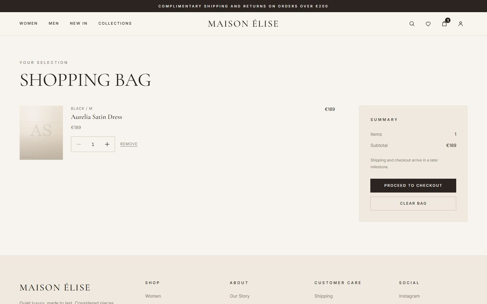
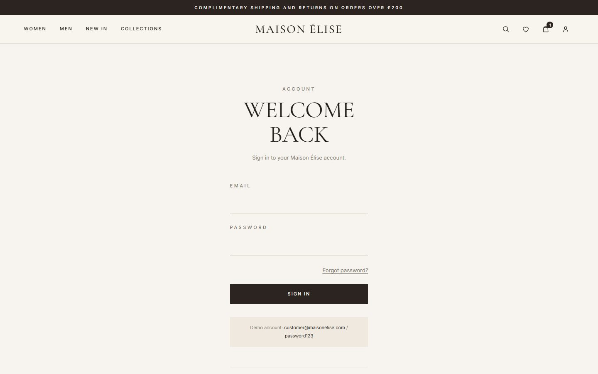

# Maison Élise

**A full-stack fashion e-commerce portfolio project** — a React storefront, a React admin dashboard
and a TypeScript/Express API with Prisma, PostgreSQL and Stripe, in a single pnpm monorepo.

> Maison Élise is a portfolio application built to demonstrate realistic commerce engineering. It is
> **not** an operating business: there are no real customers, sales or production deployments.

[](.github/workflows/ci.yml)

---

## Project Preview

Authentic screenshots captured from the running production build (desktop and mobile):

| Homepage | Shop |
| --- | --- |
|  |  |

| Product detail | Cart |
| --- | --- |
|  |  |

| Sign in | Mobile |
| --- | --- |
|  |  |

The admin dashboard and authenticated checkout screens require an admin/customer account, so they are
not shown here. See the [screenshot checklist](docs/screenshots/README.md) if you want to capture them
locally.

## Live Demo

**Live demo: not deployed yet.** No production URLs exist. Deployment steps and required credentials
are documented in [`docs/DEPLOYMENT.md`](docs/DEPLOYMENT.md) and
[`docs/DEPLOYMENT_CHECKLIST.md`](docs/DEPLOYMENT_CHECKLIST.md).

## Key Features

**Storefront**
- Responsive design (mobile → desktop) with a quiet-luxury visual identity.
- Server-side catalogue: filtering, sorting, search and pagination (`GET /products`).
- Product detail with variants (size/colour), live stock and per-variant pricing.
- Guest cart persisted locally, merged into the server cart on login/registration.
- Checkout with saved shipping addresses; orders store immutable item and shipping snapshots.
- Stripe (test mode) payment via the Payment Element; confirmed only by a signed webhook.
- Account order history and order detail.

**Admin dashboard**
- Dashboard aggregates; orders with an explicit status state machine and per-order email history.
- Product and variant creation/editing; inventory adjustment; category management; customer
  list/detail.
- Authorization is enforced by the API, not the UI.

**Platform**
- JWT authentication in an HttpOnly cookie with customer/admin roles.
- Transactional email (Resend) behind a provider abstraction, with delivery tracking and idempotency.
- Production hardening: fail-fast config validation, Helmet, CORS allow-list, CSRF origin validation,
  rate limiting, structured logging with request IDs, health/readiness endpoints, graceful shutdown.
- 255 automated tests, CI, Dockerfiles and per-route SEO metadata.

## Technology Stack

| Area | Choice |
| --- | --- |
| Monorepo | pnpm workspaces (`pnpm@11`, Node 22) |
| Language | TypeScript (strict, ESM) |
| Frontend | React 19, Vite, React Router 8 |
| State | Redux Toolkit 2 + RTK Query |
| Backend | Node.js, Express 5 |
| Database | PostgreSQL (Supabase) + Prisma 7 |
| Validation | Zod 4 |
| Auth | JWT in an HttpOnly cookie, `CUSTOMER`/`ADMIN` roles |
| Payments | Stripe 22 (test mode) |
| Email | Resend 6 (logging fallback) |
| Tests | Node test runner, Vitest, React Testing Library, Playwright |
| Quality | ESLint (flat config), Prettier, GitHub Actions, Docker |

## Architecture

```
React (Vite) → RTK Query → Express API → Services → Repositories → PostgreSQL
```

```
maison-elise/
├── apps/
│   ├── web/         Customer storefront (React + Vite)
│   ├── admin/       Admin dashboard (React + Vite)
│   └── api/         REST API (Express + Prisma)
├── packages/
│   └── shared/      Shared API contract types and constants
├── docs/            Architecture, case study, API, deployment, walkthrough
├── e2e/             Playwright specs
├── docker-compose.yml
└── .github/workflows/  CI + deploy
```

Full diagrams and flow descriptions: [`docs/ARCHITECTURE.md`](docs/ARCHITECTURE.md).

## Getting Started

**Requirements:** Node.js ≥ 20 (`.nvmrc` pins 22), pnpm (pinned via `packageManager`), and a
PostgreSQL database (the project uses Supabase). The application **requires a database** to run.

```bash
pnpm install
```

### Environment files

Copy the examples and fill in values. Never commit real `.env` files.

```bash
cp apps/api/.env.example apps/api/.env
cp apps/web/.env.example apps/web/.env
cp apps/admin/.env.example apps/admin/.env
```

`apps/api/.env` requires at least `DATABASE_URL` and `JWT_SECRET`.

### Database setup (safe Prisma workflow)

```bash
pnpm db:migrate     # prisma migrate deploy — apply committed migrations (non-destructive)
pnpm db:seed        # optional: seed the demo catalogue
# or: pnpm db:setup  # migrate + generate + seed
```

Never use `prisma migrate reset` or `db push` against a shared/production database.

### Run the applications

```bash
pnpm dev                                   # shared build, then web + admin + api in parallel
# or individually:
pnpm --filter @maison-elise/web dev        # http://localhost:5173
pnpm --filter @maison-elise/admin dev      # http://localhost:5174
pnpm --filter @maison-elise/api dev        # http://localhost:4000
```

In development Vite proxies `/api` to `http://localhost:4000`, so the storefront and API share an
origin. Health check: `GET http://localhost:4000/api/v1/health`.

**Optional integrations:** payments return `503` until `STRIPE_SECRET_KEY` is set, and transactional
email is logged (not sent) without `EMAIL_PROVIDER_API_KEY`. The rest of the app runs normally.

## Testing

```bash
pnpm lint          # ESLint
pnpm typecheck     # tsc --noEmit across workspaces
pnpm test          # API (167) + web (73) + admin (15) = 255 tests
pnpm format:check  # Prettier
pnpm build         # production builds
pnpm test:e2e      # Playwright (skipped unless E2E_BASE_URL + a test stack are provided)
```

The backend suite is **database-free** (repositories/Prisma are mocked), so CI needs no database. See
[`docs/TESTING.md`](docs/TESTING.md).

## Production Builds

```bash
pnpm build
NODE_ENV=production node apps/api/dist/server.js   # API (compiled JS)
pnpm --filter @maison-elise/web preview            # storefront (after build)
pnpm --filter @maison-elise/admin preview          # admin (after build)
```

The API validates configuration at startup and **refuses to boot** in production with a weak
`JWT_SECRET` or localhost database/client URLs.

## Deployment

**Status: not deployed.** Dockerfiles, a Compose file and GitHub Actions workflows exist and are
documented, but no production environment, domain or provider credentials have been provisioned.

- Guide: [`docs/DEPLOYMENT.md`](docs/DEPLOYMENT.md)
- Remaining manual actions: [`docs/DEPLOYMENT_CHECKLIST.md`](docs/DEPLOYMENT_CHECKLIST.md)

Stripe stays in **test mode**; live payments are intentionally out of scope.

## Engineering Decisions

A few of the decisions worth reading about (full detail in
[`docs/TECHNICAL_DECISIONS.md`](docs/TECHNICAL_DECISIONS.md)):

- **Backend-authoritative pricing & transactional checkout** — order prices come from the database and
  stock is decremented conditionally inside one transaction, so the last unit cannot be oversold.
- **Immutable order snapshots** — items and shipping addresses are copied onto the order, so later
  catalogue/address edits never change history.
- **Stripe webhook as the payment source of truth** — raw-body signature verification plus an
  event-claim table make webhook handling idempotent.
- **Email delivery tracking** — unique dedupe keys prevent duplicate sends and a recovery command
  handles interrupted deliveries.
- **Repository seam for testability** — persistence is wrapped so the API test suite can run without a
  database (Node's `mock.method` cannot stub Prisma 7's proxy delegates).

## Known Limitations

- **Not deployed** — no live URL; see the deployment checklist.
- **Stripe is test-only** and unverified without credentials.
- **Email delivery is unverified** (logging fallback without a provider key).
- **Cloudinary is not integrated** — product images are static SVGs served by the API.
- **SEO is client-rendered** — product metadata is applied after hydration, so non-JS crawlers and most
  social scrapers need prerendering/SSR to see it.
- **Full E2E and Lighthouse runs were not performed** (no isolated test stack/browser tooling).
- **No JWT revocation**; registration reveals account existence (`EMAIL_IN_USE`).

## Documentation

| Document | Contents |
| --- | --- |
| [`docs/ARCHITECTURE.md`](docs/ARCHITECTURE.md) | System diagram, components, auth/checkout flows |
| [`docs/CASE_STUDY.md`](docs/CASE_STUDY.md) | Overview, decisions, challenges, testing, limitations |
| [`docs/TECHNICAL_DECISIONS.md`](docs/TECHNICAL_DECISIONS.md) | Decision records with tradeoffs |
| [`docs/API.md`](docs/API.md) | Endpoints, auth, conventions, error format |
| [`docs/DEMO_WALKTHROUGH.md`](docs/DEMO_WALKTHROUGH.md) | 5–7 minute interview demo script |
| [`docs/PORTFOLIO_COPY.md`](docs/PORTFOLIO_COPY.md) | CV / portfolio / interview copy |
| [`docs/DEPLOYMENT.md`](docs/DEPLOYMENT.md) | Hosting, DNS, Stripe/email setup, rollback |
| [`docs/DEPLOYMENT_CHECKLIST.md`](docs/DEPLOYMENT_CHECKLIST.md) | Remaining deployment actions |
| [`docs/TESTING.md`](docs/TESTING.md) | Test strategy and commands |
| [`apps/api/README.md`](apps/api/README.md) | API/database deep dive |

## Scripts

| Script | Description |
| --- | --- |
| `pnpm dev` | Build shared, then run all workspaces in dev mode |
| `pnpm build` | Build all workspaces (topological order) |
| `pnpm lint` / `pnpm format` / `pnpm format:check` | Lint / format / check formatting |
| `pnpm typecheck` | Build shared, then typecheck all workspaces |
| `pnpm test` / `pnpm test:coverage` | Run test suites / coverage |
| `pnpm test:e2e` | Playwright E2E (requires `E2E_BASE_URL`) |
| `pnpm sitemap` | Regenerate the storefront sitemap from the API |
| `pnpm db:migrate` / `pnpm db:seed` / `pnpm db:setup` | Prisma migrate / seed / setup |
| `pnpm prisma:generate` | Generate the Prisma client |

## Repository status

The project currently has **no Git repository** (`.git` is absent). A `.gitignore` is in place
(excluding `node_modules`, build output, coverage, test artifacts and `.env*` except examples). To
start version control locally:

```bash
git init
git add -A
git status        # review — confirm no secrets are staged
git commit -m "Initial commit: Maison Élise"
```

Do not push to a remote until you have reviewed the staged files.

## Author

**[Your Name]** — add your portfolio, GitHub and LinkedIn links here.

---

*Maison Élise is a personal portfolio project. Product imagery is illustrative; no real commercial
activity is represented.*
