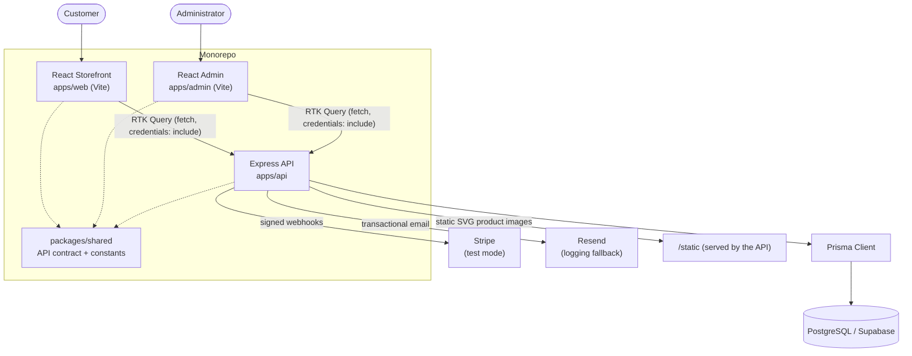
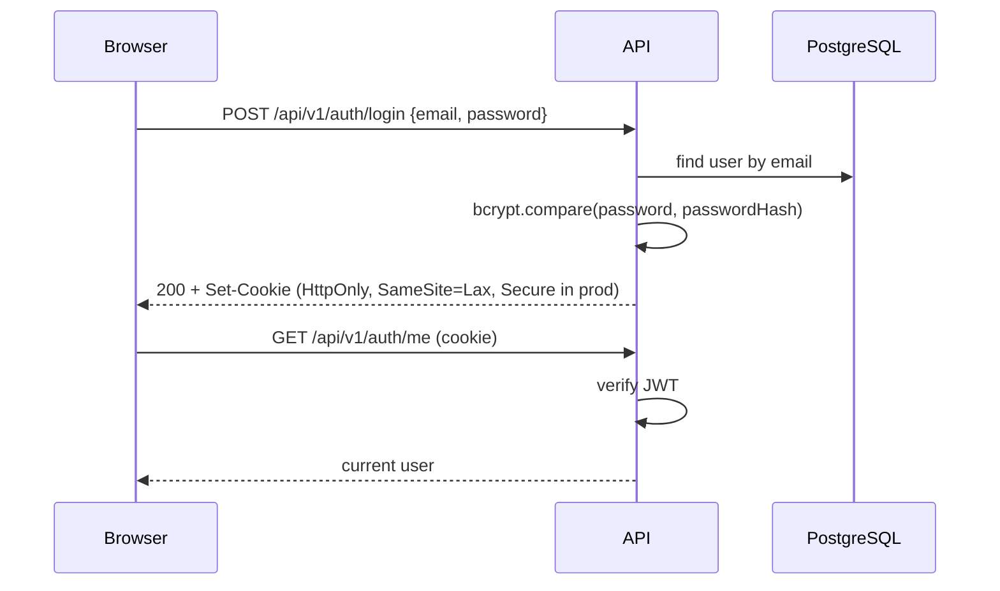
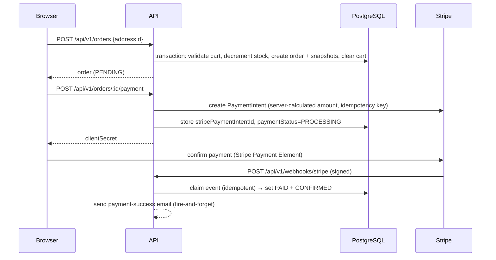

# Architecture

Maison Élise is a pnpm monorepo containing two React frontends and a TypeScript REST API that share a
single contract package and a PostgreSQL database.

## System overview

**Legend / configuration status**

| Integration | Status in this repository |
| --- | --- |
| PostgreSQL / Supabase | **Configured** — `DATABASE_URL`; migrations committed and applied to the development database |
| Stripe | **Code-complete, test mode** — requires `STRIPE_SECRET_KEY` + `STRIPE_WEBHOOK_SECRET`; endpoints return `503` when unset |
| Email (Resend) | **Code-complete** — requires `EMAIL_PROVIDER_API_KEY`; falls back to a logging provider that records instead of sending |
| Cloudinary | **Not integrated** — product images are static SVGs served by the API from `apps/api/public/products` |
| Docker / CI | **Defined, not deployed** — multi-stage Dockerfiles and GitHub Actions workflows exist; no production environment is provisioned |

## Components

### `apps/web` — storefront (React + Vite)

- **Routing:** React Router (`createBrowserRouter`) with route-level code splitting (`React.lazy` +
  `Suspense`); the homepage and app shell stay in the initial bundle.
- **Server state:** RTK Query (`baseApi` with `credentials: 'include'`); catalogue queries cache for
  300s, mutable data (cart, orders, auth) uses default invalidation.
- **Client state:** Redux Toolkit slices for auth status, guest cart (persisted to `localStorage`),
  wishlist and UI. The auth **token is never stored client-side** — only the session cookie is used.
- **SEO:** a small `Seo` component applies per-route title, description, canonical, Open Graph,
  Twitter card and Schema.org JSON-LD client-side; private routes are `noindex`.

### `apps/admin` — administration dashboard (React + Vite)

- Same stack as the storefront, served on a separate origin in development (port 5174).
- Sections: dashboard, orders (list/detail, status transitions), products (list + create/edit with
  variants), inventory, categories and customers.
- The UI is a convenience layer only — **the API is the authorization boundary**; every
  `/api/v1/admin/*` route requires an authenticated `ADMIN` session.

### `apps/api` — REST API (Express + Prisma)

Layered: `routes → controllers → services → repositories → Prisma`.

- **Configuration** is validated at startup (`config/env.ts`); production refuses to boot with a weak
  `JWT_SECRET` or localhost database/client URLs.
- **Middleware:** request correlation id, structured logging, Helmet, CORS allow-list, CSRF
  Origin/Referer validation, rate limiting, authentication, authorization, central error handling.
- **Persistence:** Prisma repositories encapsulate all database access; services hold business logic
  and open transactions.

### `packages/shared`

Framework-agnostic TypeScript compiled to ESM. Holds the API contract (`ProductDto`, `CartResponse`,
`OrderDto`, `AuthUser`, `ApiErrorBody`, …), pagination/sort types and constants (`API_PREFIX`,
`APP_NAME`). Both frontends and the API depend on it, so request/response shapes cannot drift.

## Key flows

### Authentication

### Checkout and payment

## Why these choices (mechanisms)

- **Monorepo + shared contract:** a single `packages/shared` package is consumed by both frontends and
  the API, so a change to a DTO is a compile error everywhere rather than a runtime surprise.
- **Repositories + transactions:** all multi-step writes (order creation, cancellation, address
  defaults, webhook transitions) run in a Prisma transaction, so partial state cannot persist.
- **Backend-authoritative pricing:** order line prices are read from `ProductVariant.price` inside the
  transaction; the request never carries prices or totals.
- **Stripe as the payment source of truth:** the API never marks an order paid from a client call; only
  a signature-verified webhook does, and webhook events are claimed once via a unique constraint.
- **Idempotent email:** each delivery is keyed by a unique `dedupeKey`, so retries and duplicate
  webhooks cannot send twice.

See [`TECHNICAL_DECISIONS.md`](TECHNICAL_DECISIONS.md) for tradeoffs and alternatives.
